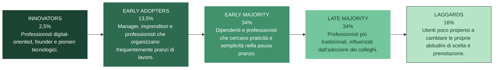
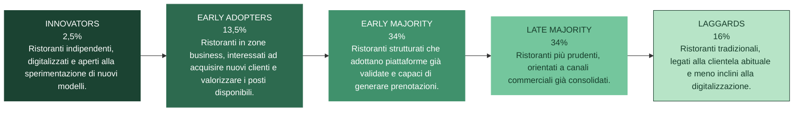

# Guida del canvas

Questo file è la fonte del Lean Canvas. A ogni refresh la pagina lo rilegge. Va aperto da un server locale, nella stessa cartella: con un doppio clic il browser non può leggere il Markdown.

## Blocchi

Un blocco è il testo fra due commenti HTML, ciascuno da solo sulla propria riga. L’apertura contiene solo `start:nome`. La chiusura contiene solo `end:nome`.

```
<!-- start:problem -->
## Il problema
testo del blocco
<!-- end:problem -->
```

Lo stesso nome può aprirsi più volte: il canvas unisce i tratti nell’ordine del file. Un’apertura chiude il blocco precedente. Il testo fuori da questi segni non entra in nessun riquadro. Un nome che non è nella lista sotto viene ignorato.

| Nome | Riquadro |
| --- | --- |
| problem | Problema |
| solution | Soluzione |
| value | Proposta di valore |
| segments | Segmenti di clientela |
| channels | Canali |
| revenue | Flussi di ricavo |
| cost | Struttura dei costi |
| metrics | Metriche chiave |
| advantage | Vantaggio sleale |

Senza `start` e `end` il riquadro resta «Da definire». Se il testo di `revenue` contiene la parola ipotesi, il riquadro è segnato «Listini da verificare».

## Cosa si vede

Nel riquadro compaiono le prime tre righe del testo delimitato. Il titolo apre il testo integrale di quel tratto, con titoli, elenchi e tabelle. Il grassetto del Markdown, scritto con due asterischi, resta grassetto nel pannello.

## Punti

Dentro un blocco, una sottolineatura HTML diventa un punto di quel blocco e resta sottolineata nel testo integrale. Con l’attributo `block` il punto va a un altro riquadro: al posto di channels si scrive uno dei nomi della tabella.

```
<u>testo</u>
<u block="channels">testo</u>
```

La sottolineatura sta dentro un solo paragrafo, una sola voce di elenco o una sola cella. Non attraversa un a capo vuoto. Lo stesso testo sottolineato due volte nello stesso blocco conta una volta. Sul riquadro un punto lungo sta su due righe; cliccandolo si apre e si può riscrivere. La sottolineatura nel file non cambia.

## Modifiche nel browser

Sottolinea, nel pannello, aggiunge un punto solo in questo browser, senza scrivere nel file. Aggiungi, passando sul riquadro, inserisce un punto vuoto. Queste modifiche restano in questo browser. Dal documento le scarta e torna alle sottolineature del file. Se il file cambia dopo una modifica fatta nel browser, il riquadro tiene la versione del browser e propone Aggiorna dal file.

---

# TAB. - Lean Business Model Canvas

## Overview

TAB. è l’app che ti permette di confrontare menu, scoprire offerte last minute e prenotare il tavolo giusto, tutto in un unico posto. Che tu voglia pranzare da solo o organizzare un Business Lunch con colleghi, clienti e contatti professionali.

In una prima fase, TAB. si concentrerà sulla pausa pranzo dei professionisti che lavorano in presenza: aziende, studi professionali, società di consulenza, realtà finanziarie e coworking. Il go-to-market partirà naturalmente dai settori finance, legal, consulting ed entrepreneurship, dove il pranzo rappresenta spesso anche un’occasione di relazione e business.

Il mercato potenziale è vasto: professionisti, imprenditori e chiunque utilizzi il pranzo o la cena come momento di incontro, confronto e networking. Il target non è definito tanto dalla professione, quanto dal comportamento, persone che hanno bisogno di trovare una location, fissare un business lunch o dinner e condividere un invito chiaro con colleghi, clienti e contatti.

### Il Trend

Calendly ha trasformato un gesto in un’abitudine: «Ti mando un Calendly», «Ho prenotato uno slot». Fissare un appuntamento non richiede più infinite conversazioni per trovare un orario condiviso.

TAB. punta a fare lo stesso per i business lunch / dinner. «Ti mando un TAB», «Fissiamo su TAB». Chi riceve l’invito trova già tutto ciò che serve per decidere: locale, menu, prezzo, orario e disponibilità. Può confermare oppure proporre un’alternativa. La prenotazione si conclude all’interno dello stesso invito, senza disperdersi tra messaggi, link e conversazioni.

Il primo rilascio si concentrerà sulla pausa pranzo, partendo da Milano e dalle principali zone ufficio. È il momento più ricorrente della giornata lavorativa, caratterizzato da tempi ridotti e decisioni spesso prese all’ultimo minuto.

La stessa esperienza si estende naturalmente ai business lunch e alle cene di lavoro. Professionisti, imprenditori e business operator potranno utilizzare TAB. per organizzare un incontro con un cliente in città, un appuntamento con un potenziale partner o una cena con un socio. Non sono occasioni che richiedono prodotti diversi: cambia il momento della giornata, non il bisogno. **TAB. è un unico modo per scegliere dove mangiare, invitare qualcuno e confermare un tavolo.**

### Business Lunch

Il feed dedicato ai menu pranzo dei ristoranti. Ogni proposta mostra in modo trasparente cosa comprende il menu, quanto costa, dove si trova il locale e in quali fasce orarie è disponibile. L'utente può esplorare e confrontare le proposte, filtrare per zona, prezzo e preferenze, scegliere il ristorante e prenotare direttamente tramite TAB..

Non sono necessari sconti o promozioni: ogni ristorante può pubblicare la propria offerta pranzo ordinaria e ricevere prenotazioni anche a prezzo pieno. Il pagamento si può configurare direttamente in app o al ristorante. TAB. ricava dal ristorante, sulle prenotazioni fatte in app, la commissione per coperto.

- **Valore per i professionisti:** rendere ogni proposta pranzo facilmente consultabile, confrontabile e prenotabile, trasformando TAB. in un punto di riferimento quotidiano per chi lavora. 
- **Valore per i ristoranti:** aumentare la visibilità, raggiungere nuovi clienti e generare prenotazioni ricorrenti attraverso un canale di acquisizione aggiuntivo.

### Offerte Flash

Proposte business lunch a prezzo ridotto, disponibili in quantità limitata e per una finestra temporale definita. **I ristoranti le attivano per valorizzare i posti che rischiano di rimanere vuoti e trasformare la capacità inutilizzata in nuove prenotazioni**. L'utente visualizza il prezzo finale, lo confronta con il prezzo ordinario del menu, acquista e riceve la conferma della prenotazione.

- **Valore per gli utenti:** accedere a menu e ristoranti a prezzi vantaggiosi, scoprendo opportunità last minute senza rinunciare alla qualità e alla comodità della prenotazione.
- **Valore per i ristoranti:** monetizzare i posti che rischierebbero di rimanere vuoti, generare domanda incrementale e acquisire nuovi clienti senza modificare il menu ordinario.

### Business **Circle**

Un professionista sceglie un pranzo e crea un invito condivisibile con colleghi, clienti o altri contatti. Può aggiungere direttamente i partecipanti oppure inviare loro l’invito: ciascuno visualizza ristorante, menu, prezzo e orario e decide se aderire. **La logica è la stessa in entrambe le sezioni. Cambia il modo in cui viene confermato e impegnato il posto:** 

- **Business Lunch.** L’organizzatore invita i partecipanti e stabilisce una scadenza per confermare le presenze. Una volta raggiunto il numero definitivo, TAB. inoltra o consolida la prenotazione con il ristorante, in base alla disponibilità.

  Il pagamento avviene direttamente al locale, senza commissioni per l’utente. L’utilizzo dei buoni pasto dipende dalle convenzioni e dalle modalità di pagamento effettivamente accettate dal ristorante.
- **Offerte Flash.** Ogni partecipante acquista individualmente il proprio menu. L’invito permette di aderire esclusivamente per i posti ancora disponibili e prima della scadenza dell’offerta. Il posto viene riservato solo dopo il completamento dell’acquisto: chi non paga non occupa posti e non genera costi per gli altri partecipanti. La disponibilità si aggiorna automaticamente a ogni acquisto.

---

Per definire e analizzare la struttura del progetto, abbiamo scelto di utilizzare il Business Model Canvas, uno strumento strategico che permette di rappresentare in modo semplice e organico i principali elementi di un modello di business. Attraverso **nove dimensioni interconnesse**, il Canvas consente di comprendere come un progetto crea, distribuisce e genera valore, mettendo in relazione i bisogni dei clienti, la proposta di valore, le attività operative e le logiche economiche alla base dell'iniziativa. 

Di seguito vengono approfonditi i nove elementi del Business Model Canvas, con l'obiettivo di delineare il funzionamento del progetto, le sue opportunità di mercato e le condizioni necessarie per sviluppare un modello sostenibile e scalabile.

## Problema

La pausa pranzo dura in media 45 minuti. In questo intervallo il professionista deve trovare un ristorante vicino all'ufficio, capire cosa offre, quanto spenderà e verificare che ci sia effettivamente posto.

Apre una chat, propone un locale, verifica la disponibilità, discute il prezzo e aspetta una conferma. Che si tratti di un pranzo veloce da solo durante la pausa, di un pranzo con i colleghi o di un business lunch con un cliente, il problema è lo stesso: trovare il posto giusto, al momento giusto, senza perdere tempo in una trattativa.

Gli Innovators sono i professionisti che lavorano negli ecosistemi finance, legal, consulting ed entrepreneurship: banche, studi professionali, società di consulenza e aziende. Persone che pranzano fuori più volte a settimana, da sole o in compagnia, e che hanno poco tempo per decidere dove andare, quanto spendere e trovare un posto disponibile.

Il bisogno si estende naturalmente a imprenditori, manager e a chiunque faccia business: persone che hanno bisogno di organizzare un pranzo o una cena, personale o professionale, senza trasformare ogni prenotazione in una negoziazione.

Partiamo dai professionisti per creare un’abitudine quotidiana. Quando saranno loro a rendere TAB. un comportamento ricorrente, il resto del mondo business seguirà.

### Il professionista

La pausa pranzo dura in media 45 minuti. In questo intervallo il professionista deve trovare un ristorante vicino all'ufficio, capire cosa offre, quanto spenderà e verificare che ci sia effettivamente posto.

Oggi queste informazioni sono frammentate tra Google Maps, siti dei ristoranti, menu online, telefonate e piattaforme di prenotazione. Per conoscere il prezzo effettivo, verificare l'accettazione dei buoni pasto o capire se il servizio è compatibile con i suoi tempi, spesso deve contattare direttamente il locale.

Il risultato è che finisce per tornare sempre negli stessi posti, non necessariamente perché siano i migliori, ma perché rappresentano la scelta più semplice e prevedibile.

Il problema non è trovare un ristorante, ma trovare rapidamente quello giusto: vicino, compatibile con il tempo disponibile, con un prezzo chiaro, un'offerta interessante e un posto realmente disponibile.

### Il professionista che organizza il pranzo

La pausa pranzo è anche un momento di socialità e relazione professionale. Secondo un'indagine Edenred–BVA Doxa, tra i dipendenti delle aziende che erogano buoni pasto, 6 persone su 10 pranzano con i colleghi e più della metà parla di lavoro durante il pasto.

Questo rende il pranzo un'occasione ricorrente di incontro, confronto e networking. Ma organizzarlo è ancora sorprendentemente macchinoso.

Qualcuno deve proporre un locale, condividere il menu, comunicare il prezzo, raccogliere le adesioni e verificare la disponibilità per tutto il gruppo. La chat diventa il centro dell'organizzazione, ma non risolve il problema: le informazioni arrivano in momenti diversi, le conferme sono frammentate e spesso prezzo e disponibilità vengono verificati solo dopo aver coinvolto tutti.

Nel business lunch si aggiunge un'altra variabile: chi invita mette in gioco la propria immagine professionale. Deve poter proporre un'esperienza adeguata, con menu, prezzo e orario definiti, senza rischiare brutte sorprese.

Il problema è trasformare una proposta in una prenotazione condivisa: tutti devono sapere dove si va, cosa si mangia, quanto si spende e avere la certezza che il tavolo sia effettivamente confermato.

### Il ristorante

Il ristorante deve raggiungere persone che si trovano nelle vicinanze, nel momento in cui stanno decidendo dove mangiare. Ma essere presenti online o sulle mappe non significa necessariamente entrare nella loro scelta.

Durante il servizio, la domanda è variabile: alcuni tavoli sono pieni, altri restano vuoti. Questi ultimi rappresentano capacità disponibile che, una volta trascorsa la fascia di servizio, non può più essere recuperata.

Il ristoratore ha quindi due esigenze: acquisire nuovi clienti abituali e valorizzare i coperti che rischierebbero di rimanere invenduti. Per farlo, deve poter pubblicare rapidamente menu e disponibilità, decidere autonomamente prezzo, quantità e fascia oraria e conoscere il ricavo netto dopo le commissioni.

Il problema è trasformare la capacità disponibile in prenotazioni concrete: raggiungere nuovi clienti nella propria zona, riempire i tavoli e generare fatturato incrementale senza compromettere la marginalità.

**Nell'analisi Bloom Intelligence del 2025, condotta su ristoranti full-service e quick-service negli Stati Uniti, solo circa il 25% di chi entra per la prima volta torna entro 90 giorni. Circa il 69% degli ospiti resta una visita sola e, tra chi era già cliente, il 78,8% non si ripresenta nell'anno successivo. Chi diventa abituale vale circa 26 volte un ospite che non torna. Il tavolo vuoto e il cliente che non si rivede sono lo stesso problema: per il ristorante, e per TAB., il valore sta nel far tornare le persone.**

| Chi                                   | Il problema, in una riga                                                                                                                                                                                |
| ------------------------------------- | ------------------------------------------------------------------------------------------------------------------------------------------------------------------------------------------------------- |
| **Professionista – Early Adopter**    | ++Trovare rapidamente dove pranzare, anche da solo, durante la pausa pranzo: vicino all’ufficio, con menu, prezzo, modalità (buoni pasto) e disponibilità chiari.++                                     |
| **Imprenditori e business operators** | ++Trasformare una proposta ai colleghi o a un cliente in una prenotazione condivisa, con menu, prezzo, modalità, adesioni e coperti confermati. Senza perdere tempo tra chat, telefonate e verifiche.++ |
| **Ristoratore**                       | ++Intercettare nuovi clienti, aumentare la visibilità nella propria zona e convertire i coperti disponibili in prenotazioni, valorizzando la capacità inutilizzata.++                                   |

---

## 1. Customer Segment

TAB. opera su due segmenti complementari: **Professionisti (B2C)** e **Ristoranti (B2B)**. Il lancio iniziale li sviluppa simultaneamente all'interno dello stesso bacino geografico, partendo da Milano e concentrandosi su microzone ad alta densità di uffici e attività di ristorazione raggiungibili a piedi.

## Professionisti – B2C

Il pubblico comprende dipendenti, liberi professionisti, imprenditori e business operator che utilizzano il pranzo e la cena come momenti di pausa, relazione e lavoro.



## Ristoranti – B2B

Il segmento comprende ristoranti, bistrot, trattorie e locali con servizio pranzo, che si posizionano in una fascia medio-alta / alta,  nelle zone ad alta concentrazione di uffici di Milano. TAB. si rivolge a strutture interessate ad acquisire nuova clientela professionale, aumentare la visibilità della propria offerta e ottimizzare l'occupazione dei tavoli.



---

## 2. Proposta di valore

**Una piattaforma per semplificare la pausa pranzo e rendere più facile organizzare un Business Lunch.**

TAB. nasce per semplificare il modo in cui i professionisti scelgono, prenotano e organizzano business lunch. Da un lato, aiuta i professionisti a trovare rapidamente il ristorante più adatto alle proprie esigenze, conoscere in anticipo menu e prezzi e condividere un invito completo con colleghi, clienti e contatti. Dall'altro, offre ai ristoranti un canale aggiuntivo per raggiungere nuovi clienti, gestire le prenotazioni e valorizzare la disponibilità dei propri tavoli.

TAB. non vuole essere soltanto un catalogo di ristoranti o una piattaforma di sconti. Il suo elemento distintivo è integrare la scoperta dei locali, la prenotazione e l'organizzazione delle persone all'interno della stessa esperienza. Il comportamento che il prodotto vuole rendere naturale è semplice: **«Ti mando un TAB».**

La proposta di valore si sviluppa attorno a due segmenti distinti ma complementari: **Professionisti** (**B2C**) e **Ristoranti** (**B2B**). La loro interazione alimenta il funzionamento della piattaforma e crea un ecosistema in cui la domanda di chi cerca un luogo in cui mangiare incontra l'offerta dei ristoratori. 

### Per i professionisti - B2C

TAB. rende più semplice trovare il posto giusto in cui mangiare, anche quando si deve decidere all'ultimo momento. L'utente può consultare le proposte dei ristoranti, conoscere in anticipo cosa comprende ogni menu, quanto costa e quando è disponibile, confrontare le alternative e prenotare direttamente dalla piattaforma.

- **Scopri e confronta.** Consulta i menu dei ristoranti vicino all'ufficio, con prezzi, contenuti e disponibilità immediatamente visibili.
- **Risparmia con le Offerte Flash.** Accedi a menu a prezzo ridotto, disponibili in quantità limitata e per finestre temporali definite, con prezzo finale e risparmio chiaramente indicati.
- **Prenota facilmente.** Scegli il ristorante più adatto alle tue esigenze e completa la prenotazione senza passaggi superflui. Nel Business Lunch non sono previste commissioni di prenotazione per l'utente.

Quando il Business Lunch coinvolge altre persone, TAB. elimina la complessità organizzativa delle conversazioni frammentate. L'organizer sceglie il ristorante e condivide un invito che contiene già tutte le informazioni necessarie: luogo, menu, prezzo, orario e posti disponibili. Chi lo riceve può consultare la proposta e decidere se partecipare.

- **Un invito, tutto già definito.** Condividi un TAB. invece di dover concordare separatamente ogni dettaglio in chat.
- **Coinvolgi le persone giuste.** Organizza un Business Lunch con colleghi, clienti e contatti, lasciando a ciascuno la possibilità di aderire.
- **Semplifica le prenotazioni di gruppo.** Raccogli le adesioni e gestisci l'organizzazione attraverso un unico processo, senza dover coordinare manualmente ogni partecipante.

Le due esperienze utilizzano la stessa infrastruttura e rispondono a esigenze differenti: TAB. è utile sia quando un professionista deve semplicemente decidere dove mangiare, sia quando vuole organizzare un Business Lunch. **L'obiettivo è diventare lo strumento di riferimento per la pausa pranzo dei professionisti e per l'organizzazione dei loro incontri professionali**.

### Per i ristoranti - B2B

TAB. offre ai ristoranti un canale digitale per raggiungere una domanda specifica: quella dei professionisti che cercano un locale per la pausa pranzo o per un Business Lunch. La piattaforma permette di promuovere i menu, aumentare la visibilità presso un pubblico geograficamente rilevante e ricevere prenotazioni, sia individuali sia di gruppo. A questo si aggiunge la possibilità di attivare offerte a prezzo ridotto per valorizzare i posti che rischiano di rimanere invenduti.

Il ristoratore può quindi utilizzare TAB. secondo due modalità complementari: promuovere la propria offerta pranzo ordinaria e generare domanda aggiuntiva attraverso le Offerte Flash.

- **Raggiungi nuovi clienti in zona.** Dai visibilità al tuo ristorante tra professionisti che cercano dove pranzare vicino al proprio ufficio, intercettando una domanda locale e ricorrente.
- **Promuovi menu e disponibilità.** Pubblica e aggiorna le proposte pranzo, rendendo consultabili menu, prezzi e fasce orarie direttamente sulla piattaforma. Le proposte possono essere prenotate anche individualmente o da gruppi di professionisti.
- **Valorizza i posti invenduti.** Attiva un'Offerta Flash quando hai capacità inutilizzata, definendo autonomamente quantità, prezzo e fascia oraria. In questo modo puoi generare domanda incrementale senza modificare l'offerta ordinaria.
- **Mantieni il controllo della redditività.** Definisci le condizioni economiche delle offerte considerando sconto e commissione applicata dalla piattaforma, così da pubblicare soltanto quando l'operazione risulta commercialmente conveniente.

Il **Business Lunch** consente al ristorante di promuovere la propria offerta ordinaria e ricevere prenotazioni. Le **Offerte Flash** permettono di monetizzare la capacità inutilizzata attraverso proposte a disponibilità limitata. Sulle prenotazioni fatte in app il piano prevede una commissione per coperto.

Questa distinzione consente a TAB. di rispondere a due esigenze diverse del ristoratore: **acquisire domanda ricorrente e valorizzare la disponibilità residua**, senza rendere obbligatorio il ricorso agli sconti.

> *La prima fase di sviluppo si concentra sulla pausa pranzo, partendo dai professionisti e dai ristoranti situati nelle aree a maggiore concentrazione di uffici. Una volta consolidato il modello iniziale, la piattaforma potrà estendere il proprio utilizzo ad altre occasioni di incontro professionale, mantenendo invariata la logica centrale di scelta, invito e prenotazione.*
>
> Il networking costituisce un valore aggiuntivo generato naturalmente dagli inviti tra colleghi, clienti e contatti professionali. Non rappresenta una funzionalità autonoma da imporre all'utente, ma una conseguenza delle occasioni di incontro facilitate dalla piattaforma. Per questa ragione non sono previsti tavoli aperti a sconosciuti né sistemi di matching tra professionisti. TAB. parte da esigenze concrete e relazioni esistenti, lasciando che il valore relazionale emerga progressivamente dall'utilizzo.

---

## 3. Canali

L'**applicazione** rappresenta il principale canale di erogazione del servizio e il punto di accesso all'intera esperienza TAB.: ricerca dei ristoranti, consultazione dei menu, visualizzazione delle Offerte Flash, creazione e condivisione dei tavoli, prenotazione e pagamento delle offerte.

Un ruolo centrale nella distribuzione e nell'acquisizione di nuovi utenti è affidato agli inviti. Il **TAB. condivisibile** funziona secondo una logica simile a un link Calendly: l'organizzatore può inoltrarlo a colleghi, clienti e contatti, anche se questi non hanno ancora installato l'applicazione. Chi riceve l'invito può partecipare al tavolo e, a sua volta, condividerlo con altre persone, innescando un meccanismo di diffusione organica. La pausa pranzo rappresenta il primo contesto di utilizzo, mentre la cena di business estende lo stesso meccanismo ad altre occasioni di incontro professionale.

A supporto della crescita saranno utilizzati anche i **principali canali social**, in particolare LinkedIn , Instagram e TikTok, con strategie e contenuti differenziati: Instagram e TikTok per aumentare visibilità e riconoscibilità del brand, LinkedIn per raggiungere direttamente professionisti, aziende e community di riferimento.

Il **passaparola** tra professionisti rappresenterà un ulteriore canale di acquisizione, facendo leva sulla natura relazionale del servizio e sulla possibilità che colleghi e contatti condividano spontaneamente tavoli e occasioni di business lunch.

Per il lancio iniziale, **Financ&youth** costituisce un primo bacino di distribuzione e acquisizione, grazie a un database di circa 2.000 contatti appartenenti a una community professionale. Questo patrimonio relazionale potrà essere utilizzato per individuare i primi utenti da coinvolgere, validare il servizio e attivare i primi organizzatori, senza considerare l'intero database come un bacino di utenti già acquisiti.

Infine, le zone ad alta concentrazione di uffici rappresentano il principale riferimento per la distribuzione fisica del servizio. La strategia iniziale prevede di concentrare l'attivazione di utenti e ristoranti all'interno di specifiche microzone urbane, creando una densità sufficiente affinché l'offerta sia facilmente raggiungibile durante una normale pausa pranzo.

| Canale                                    | Ruolo                           | Funzione principale                                                                                                                          |
| ----------------------------------------- | ------------------------------- | -------------------------------------------------------------------------------------------------------------------------------------------- |
| **App TAB.**                        | Canale di erogazione            | Ricerca ristoranti, consultazione menu, Offerte Flash, creazione e condivisione dei tavoli, prenotazione e pagamento.                        |
| **Inviti e TAB. condivisibili**     | Distribuzione e acquisizione    | Condivisione dei tavoli tramite link con colleghi, clienti e contatti, favorendo la partecipazione e la diffusione organica del servizio.    |
| **Instagram e TikTok**                    | Marketing e awareness           | Aumentare la visibilità del brand, mostrare le esperienze e raggiungere nuovi utenti.                                                        |
| **LinkedIn**                              | Distribuzione e acquisizione    | Raggiungere professionisti, aziende e community di riferimento.                                                                              |
| **Word of mouth**                         | Acquisizione organica           | Favorire il passaparola tra colleghi e professionisti attraverso la condivisione di tavoli e occasioni di business lunch.                    |
| **Financ&youth**                          | Bacino iniziale di acquisizione | Attivare il database di circa 2.000 contatti per individuare i primi utenti, organizzatori e partecipanti.                                   |
| **Zone ad alta concentrazione di uffici** | Distribuzione e acquisizione    | Concentrare inizialmente utenti e ristoranti nelle stesse microzone, garantendo un'offerta facilmente raggiungibile durante la pausa pranzo. |

---

## 5. Flussi di ricavo

Il modello di ricavo di TAB. si basa su due componenti complementari, applicate al  ristorante ma legate a servizi e attività differenti. La prima è un **canone di abbonamento**, che remunera la presenza del ristorante sulla piattaforma e la possibilità di pubblicare i propri menu e ricevere prenotazioni. La seconda è una **commissione sulle prenotazioni**, calcolata per ogni coperto prenotato e pagato tramite l'app. In questo modo, TAB. combina una componente di ricavo ricorrente con una variabile, direttamente collegata all'attività generata dalla piattaforma.

Nel dettaglio, il canone prevede una fase iniziale senza ricavi nel 2027, per poi essere introdotto a 49 euro mensili nel 2028 e aumentare a 59 euro mensili a partire dal 2029. Il suo contributo alla composizione dei ricavi cresce progressivamente, arrivando a rappresentare circa il 25% nel 2028, per poi attestarsi al 13% nel 2031.

La commissione sulle prenotazioni costituisce invece la principale fonte di monetizzazione per tutto il periodo considerato. Il piano ipotizza un'aliquota del 15% fino al 2029, con una progressiva riduzione al 13% nel 2030 e al 10% nel 2031. Nonostante la riduzione percentuale, la crescita dei volumi di prenotazione ne sostiene l'espansione: il suo peso passa dal 100% dei ricavi nel 2027 all'87% nel 2031.

Nel complesso, il piano prevede una crescita dei ricavi da 14.164 euro nel 2027 a circa 4,08 milioni di euro nel 2031. A sostenere questa evoluzione è soprattutto l'incremento dei coperti intermediati, che passano da 7.600 a circa 1,96 milioni nello stesso periodo.

### Prezzo

| Anno | Canone mensile | Fee per coperto |
| --- | --- | --- |
| 2027 | — | 15% |
| 2028 | 49 euro | 15% |
| 2029 | 59 euro | 15% |
| 2030 | 59 euro | 13% |
| 2031 | 59 euro | 10% |

### Locali

| Anno | Utenti attivi | Pagano il canone | Con prenotazioni |
| --- | --- | --- | --- |
| 2027 | 400 | 0 | 16 |
| 2028 | 2.800 | 93 | 80 |
| 2029 | 9.300 | 244 | 168 |
| 2030 | 24.600 | 500 | 351 |
| 2031 | 51.325 | 693 | 524 |

### Coperti

| Anno | Nell’anno | A settimana per locale |
| --- | --- | --- |
| 2027 | 7.600 | 10 |
| 2028 | 71.004 | 23 |
| 2029 | 300.231 | 39 |
| 2030 | 824.932 | 55 |
| 2031 | 1.962.700 | 73 |

### Ricavi

Cifre del piano, in euro. La quota è le commissioni divise per il totale, arrotondate al punto percentuale.

| Anno | Canone | Commissioni | Totale | Quota commissioni |
| --- | --- | --- | --- | --- |
| 2027 | — | 14.163,9 | 14.163,9 | 100% |
| 2028 | 44.604,6 | 133.377,1 | 177.982,0 | 75% |
| 2029 | 146.400,7 | 565.398,4 | 711.799,1 | 79% |
| 2030 | 300.088,6 | 1.566.849,0 | 1.866.937,5 | 84% |
| 2031 | 535.523,4 | 3.546.007,4 | 4.081.530,9 | 87% |

---

## 6. Risorse chiave

Il modello di TAB. si fonda su un insieme di risorse digitali, commerciali e relazionali che permettono di mettere in connessione la domanda dei professionisti con l'offerta dei ristoranti.

- ++**Piattaforma tecnologica proprietaria++ -** L'applicazione e la relativa infrastruttura tecnologica rappresentano il nucleo operativo del modello. Integrano ricerca dei ristoranti, consultazione dei menu, prenotazioni, pagamenti delle Offerte Flash e sistema di inviti, offrendo un'esperienza unificata ai due segmenti di clientela.
- ++**Rete di ristoranti e relazioni commerciali++ -** Una rete di locali concentrati nelle microzone professionali, costruita attraverso rapporti diretti con i ristoratori e referenti in grado di confermare menu, condizioni commerciali e capacità operativa. La densità dell'offerta in una determinata area rappresenta una risorsa strategica per garantire varietà di scelta e disponibilità agli utenti.
- ++**Community e database professionale++ -** Un bacino iniziale di contatti professionali da qualificare e attivare, utile per acquisire i primi utenti, individuare gli organizzatori e generare le prime prenotazioni individuali e di gruppo. La rete professionale costituisce inoltre un potenziale canale di diffusione organica attraverso inviti e condivisioni.

---

## 7. Attività chiave

aree a maggiore concentrazione di uffici, attraverso l'acquisizione di nuovi locali e la gestione continuativa delle relazioni commerciali. Parallelamente, la piattaforma deve acquisire e attivare una base di professionisti in grado di generare prenotazioni individuali e di gruppo.

La crescita del modello dipende dalla capacità di sviluppare entrambe le componenti nello stesso territorio, raggiungendo una densità sufficiente di ristoranti e utenti. A queste attività si affiancano la gestione dell'offerta, l'intermediazione delle prenotazioni e dei pagamenti, il coordinamento degli inviti e il mantenimento di un catalogo affidabile e aggiornato.

- **Sviluppo e gestione della piattaforma tecnologica -** Sviluppare e mantenere l'infrastruttura digitale che integra ricerca, catalogo, prenotazioni, pagamenti e inviti. Garantire affidabilità dei flussi operativi, aggiornamento delle disponibilità, sicurezza delle transazioni e continuità del servizio, migliorando progressivamente l'esperienza sulla base dei dati di utilizzo e dei feedback di professionisti e ristoratori.
- **Acquisizione e gestione della rete di ristoranti -** Individuare e acquisire nuovi ristoranti nelle microzone target, costruendo relazioni dirette con i titolari e i referenti dei locali. Gestire l'onboarding dei ristoranti, raccogliere le informazioni commerciali e operative, supportare la pubblicazione dei menu e delle Offerte Flash e mantenere aggiornate le condizioni di disponibilità. L'obiettivo è costruire una rete territoriale sufficientemente ampia e diversificata da garantire agli utenti un'offerta interessante e facilmente accessibile.
- **Acquisizione e attivazione dei professionisti -** Sviluppare la base utenti attraverso il database professionale, gli inviti condivisi dagli utenti, il passaparola e i canali digitali, raggiungendo professionisti che lavorano o frequentano le aree presidiate dalla piattaforma. Curare l'acquisizione, l'onboarding e la conversione dei nuovi iscritti in utenti attivi, incentivando l'utilizzo ricorrente per la pausa pranzo e l'organizzazione dei Business Lunch.
- **Aggiornamento e controllo dell'offerta -** Verificare quotidianamente la corrispondenza tra le informazioni pubblicate sulla piattaforma e l'offerta effettivamente disponibile nei ristoranti. Mantenere aggiornati menu, prezzi, orari e disponibilità attraverso il coinvolgimento dei locali.

---

## 8. Partner chiave

Il modello di TAB. si basa su una rete di partner commerciali, territoriali e tecnologici che contribuiscono allo sviluppo dell'offerta, all'acquisizione degli utenti e alla gestione delle operazioni. La priorità è costruire collaborazioni nelle stesse aree geografiche, mettendo in relazione i ristoranti con le comunità professionali che lavorano nelle zone presidiate dalla piattaforma.

- **Ristoranti e attività di ristorazione -** Sono i principali partner commerciali e rappresentano il lato dell'offerta della piattaforma. Forniscono menu, prezzi, disponibilità e capacità operativa, occupandosi della preparazione e dell'erogazione del servizio in sala. Il rapporto con i ristoratori è fondamentale sia per garantire un catalogo aggiornato e diversificato, sia per generare prenotazioni individuali e di gruppo
- **Community e network professionali -** Le community professionali rappresentano un importante canale di accesso a potenziali utenti e organizzatori di Business Lunch. Financ&youth costituisce il primo bacino di acquisizione, a cui si affiancano altre realtà e network professionali, come NetLeg e Canvoa, con cui sviluppare possibili collaborazioni per raggiungere nuovi segmenti di professionisti. Queste community permettono di avviare attività di acquisizione mirate, qualificando i contatti in base alla zona lavorativa, alla frequenza di presenza in ufficio e alle abitudini legate alla pausa pranzo.
- **Aziende, uffici e studi professionali -** Rappresentano potenziali partner territoriali per raggiungere gruppi di professionisti che condividono lo stesso ambiente lavorativo e organizzano abitualmente pranzi durante la giornata. Collaborazioni con aziende, coworking, studi professionali e realtà presenti nelle aree di lancio possono favorire la diffusione della piattaforma, l'acquisizione di nuovi utenti e l'organizzazione di prenotazioni collettive.
- **Partner tecnologici -** TAB. può sviluppare partnership con fornitori di infrastrutture e servizi tecnologici necessari al funzionamento e all'evoluzione della piattaforma. Rientrano in questa categoria i circuiti e i provider di pagamento, le cui integrazioni consentono di gestire gli acquisti delle Offerte Flash e trasferire ai ristoranti gli importi di loro competenza. Ulteriori collaborazioni con operatori del settore dei buoni pasto possono abilitare il pagamento tramite ticket restaurant digitali, ampliando le modalità di pagamento disponibili per gli utenti e il numero di ristoranti convenzionati. La categoria comprende inoltre eventuali partner per integrazioni con sistemi gestionali dei ristoranti, servizi di geolocalizzazione, notifiche e altre infrastrutture tecnologiche funzionali allo sviluppo del prodotto.

---

## 9. Struttura dei costi

La struttura dei costi di TAB. è caratterizzata da una componente tecnologica e infrastrutturale, necessaria per sviluppare e mantenere la piattaforma, e da una componente commerciale e operativa legata all'acquisizione e alla gestione dei due segmenti di clientela: professionisti e ristoranti.

- **Sviluppo e manutenzione tecnologica -** Comprende i costi per progettare, sviluppare e mantenere l'applicazione, implementare nuove funzionalità e garantire affidabilità, sicurezza e continuità del servizio. Include anche i costi per infrastruttura cloud, database, hosting, API, servizi di geolocalizzazione e strumenti software di monitoraggio e analisi.
- **Acquisizione e gestione dei ristoranti -** Riguarda le attività commerciali necessarie a costruire una rete di locali nelle microzone target. Comprende scouting territoriale, acquisizione dei ristoranti, onboarding, raccolta dei menu, aggiornamento delle informazioni e gestione continuativa delle relazioni con i referenti.
- **Acquisizione dei professionisti -** Comprende gli investimenti per raggiungere e attivare nuovi utenti attraverso campagne digitali, social media, partnership con community professionali, referral e iniziative di promozione territoriale. L'obiettivo è sviluppare una base di utenti attivi nelle stesse aree geografiche in cui è presente l'offerta dei ristoranti.
- **Gestione operativa e assistenza -** Include le attività necessarie a garantire la qualità e l'affidabilità del servizio: aggiornamento dei menu, verifica delle disponibilità, gestione delle Offerte Flash, supporto agli utenti e ai ristoratori e gestione di eventuali problematiche relative a prenotazioni e acquisti.
- **Costi di pagamento e transazione -** Comprende le commissioni applicate dai provider di pagamento per elaborare gli acquisti in piattaforma oltre agli eventuali costi legati a rimborsi, contestazioni e gestione delle transazioni.
- **Costi amministrativi, legali e compliance -** Comprende le spese per contabilità, consulenza fiscale e legale, contrattualistica commerciale, protezione dei dati personali, adempimenti normativi e gestione societaria.

La struttura dei costi è destinata a evolversi con la crescita della piattaforma. Nella fase iniziale, gli investimenti saranno concentrati principalmente sullo sviluppo tecnologico, sulla costruzione della rete di ristoranti e sull'acquisizione dei primi professionisti. Con l'espansione territoriale e l'aumento dei volumi di prenotazione, assumeranno maggiore rilevanza i costi di acquisizione, gestione operativa e transazione.
